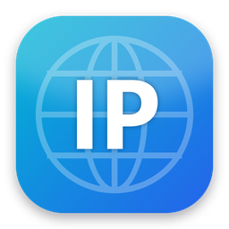
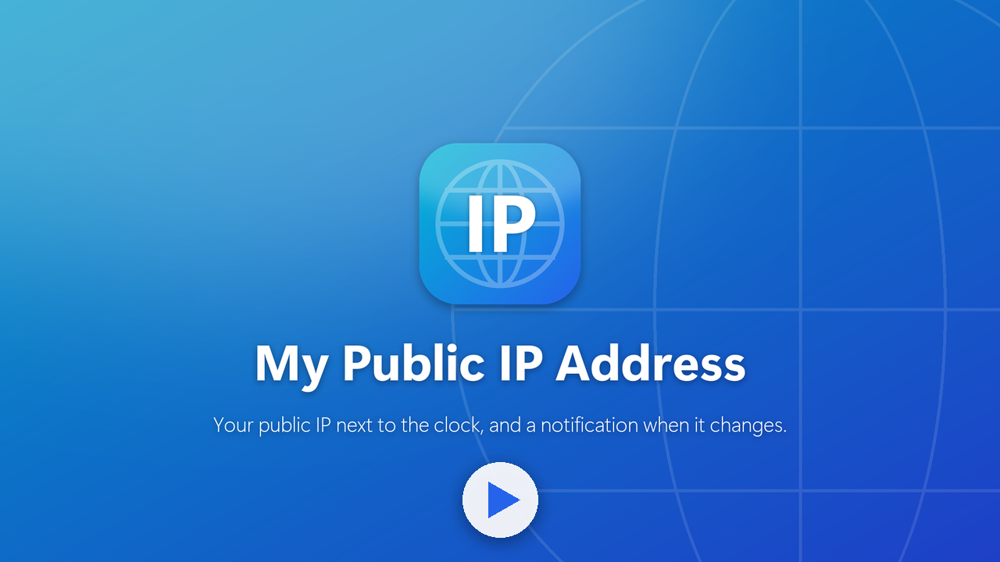
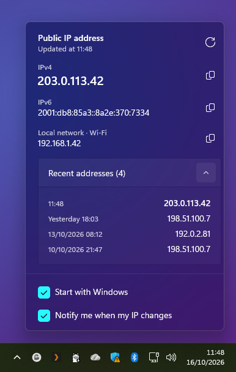
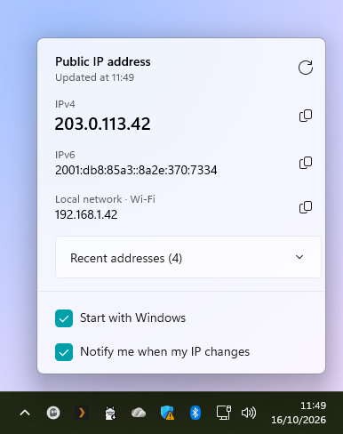
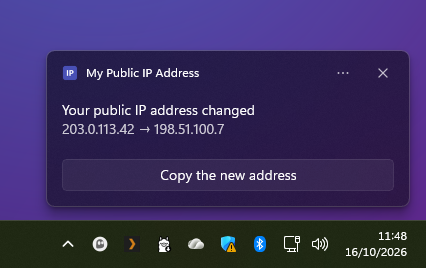
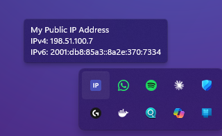
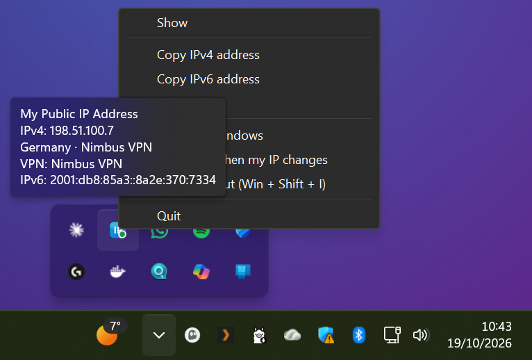
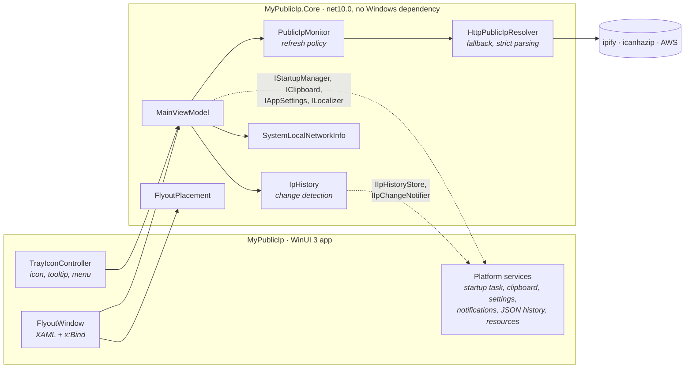

<p align="center">
  
</p>

<h1 align="center">My Public IP Address</h1>

<p align="center">
  <b>Your public IP next to the Windows clock, and a notification as soon as it changes.</b>
</p>

<p align="center">
  <a href="https://github.com/phnogues/MyPublicIp/actions/workflows/ci.yml"></a>
  
  
  
  <a href="LICENSE"></a>
</p>

<p align="center">
  <a href="https://apps.microsoft.com/detail/9NX8XP3BX8KM">
    
  </a>
</p>

<p align="center">
  <a href="docs/media/trailer.mp4">
    
  </a>
  <br />
  <sub>▶ Watch the 30-second trailer</sub>
</p>

---

Setting up a VPN, opening a port, whitelisting your office in a firewall, answering a support
technician: sooner or later you need your **public** IP address. Instead of opening a browser on a
page full of ads, *My Public IP Address* keeps it in the notification area, always up to date, and
tells you when it changes, for instance when your VPN drops.

## Features

- **Hover** the icon: the tooltip shows your public IPv4 and IPv6.
- **Click** it: a Windows 11 style flyout with your public and local addresses, one-click copy, and your recent addresses.
- **Get notified** when your public IP changes, with the old and the new address and a button to copy it.
- **Right-click** it: copy, refresh, start with Windows, notifications, quit. The menu also opens with the keyboard.
- **Always current**: refreshed when the network changes (Wi-Fi, VPN, Ethernet...), every 15 minutes,
  and retried quickly after a failure. An error is never shown or copied as if it were an address.
- **IPv4 and IPv6**, each looked up independently with fallback services.
- **Starts with Windows**, quietly. Can be turned off from the app or from Windows Settings.
- **Native look**: acrylic flyout, light and dark themes, follows the taskbar position and display scaling.
- **Private**: no account, no ads, no tracking; the history stays on your PC (see [PRIVACY.md](PRIVACY.md)).
- English and French.

## Screenshots

| Flyout, dark theme | Flyout, light theme |
| :---: | :---: |
|  |  |
| **Notification when the IP changes** | **Tooltip on hover** |
|  |  |

<p align="center">
  <br/>
  <sub>Right-click menu</sub>
</p>

<sub>Screenshots use addresses reserved for documentation (RFC 5737 and RFC 3849).</sub>

## Architecture

The solution separates the behavior from the Windows shell around it:



- **`MyPublicIp.Core`** holds all the logic: lookup, refresh policy, change detection and history,
  view model, flyout placement. It only depends on .NET and
  [CommunityToolkit.Mvvm](https://github.com/CommunityToolkit/dotnet), so it is fully unit tested.
- **`MyPublicIp`** is a thin WinUI 3 shell: the composition root ([`App.xaml.cs`](src/MyPublicIp/App.xaml.cs)),
  the views, and the Windows implementations of the Core interfaces.

### Design notes

| Topic | Choice |
| --- | --- |
| UI pattern | MVVM with source-generated properties and commands; the flyout and the tray menu share one view model. |
| Refresh policy | Periodic refresh, network changes debounced (adapters often change in bursts), increasing backoff after failures (3 s to 1 min), concurrent requests coalesced. |
| Change detection | A change is a new IPv4 or a new IPv6 /64 network: IPv6 privacy extensions rotate the rest of the address every day, which must not raise a notification. The first result of a session is recorded silently. |
| Testability | Time is injected with `TimeProvider`: refresh and backoff tests advance a fake clock instead of sleeping. |
| Robustness | Answers are parsed strictly (`IPAddress.TryParse` alone accepts `"1"`); one failing service falls back to the next; the clipboard is retried when another app holds it; the history is written atomically. |
| Notifications | Windows App SDK `AppNotificationManager`, with the COM activator declared in the manifest: a click reaches the running instance, or starts the app if it was closed. |
| Start with Windows | MSIX `windows.startupTask` instead of a Startup-folder shortcut, which a packaged app cannot create. A choice made in Windows Settings is respected. |
| Tray icon identity | Windows ties a tray icon GUID to the executable path, and every MSIX update changes that path: the GUID is derived from the path so the icon always comes back after an update. |
| Single instance | A second launch is redirected to the running instance with `AppInstance`, which then shows its flyout. |
| Packaging | Single-project MSIX with a self-contained, fully trimmed .NET 10 runtime: about 8 MB per architecture (x86 / x64 / ARM64) instead of 60 MB. JSON uses source generation, so nothing relies on reflection. |

## Project structure

```
├── src
│   ├── MyPublicIp.Core              Platform-independent logic (net10.0)
│   │   ├── Abstractions             Interfaces implemented by the app (startup, clipboard, settings...)
│   │   ├── PublicIp                 Resolver, monitor, refresh policy, snapshot
│   │   ├── History                  Address history and change detection
│   │   ├── LocalNetwork             Address on the local network
│   │   ├── Layout                   Flyout placement next to the clock
│   │   └── ViewModels               MainViewModel
│   └── MyPublicIp                   WinUI 3 app (MSIX)
│       ├── Views                    Flyout window
│       ├── Tray                     Notification area icon and menu
│       ├── Platform                 Windows implementations, notifications, Win32 interop
│       ├── Diagnostics              Debug-only demo mode for screenshots
│       ├── Strings                  en-US and fr-FR resources
│       └── Package.appxmanifest     Store identity, capabilities, startup task, notification activation
├── tests
│   └── MyPublicIp.Core.Tests        xUnit v3 tests of the Core
├── tools/generate-assets.py         Generates every icon of the package
├── Directory.Build.props            Shared build settings (warnings as errors, analyzers)
└── Directory.Packages.props         Central NuGet versions
```

## Build and run

Requirements: Windows 10 (1809) or 11, the [.NET 10 SDK](https://dotnet.microsoft.com/download/dotnet/10.0)
and, to run the app, [Developer Mode](https://learn.microsoft.com/windows/apps/get-started/enable-your-device-for-development).

**Visual Studio 2026**: open `MyPublicIp.slnx` (workload *WinUI application development*), select `x64` and press F5.

**Command line**:

```powershell
# Build and run the tests
dotnet build MyPublicIp.slnx -p:Platform=x64
dotnet test --project tests/MyPublicIp.Core.Tests/MyPublicIp.Core.Tests.csproj

# Register the app for the current user, then start "My Public IP Address" from the Start menu
Add-AppxPackage -Register src/MyPublicIp/bin/x64/Debug/net10.0-windows10.0.19041.0/win-x64/AppxManifest.xml
```

Debug builds accept `--demo` (documentation addresses, a sample history, and a new address at each
refresh to show the notification), `--theme=light|dark` and `--lang=en-US|fr-FR`. They were used for the screenshots:

```powershell
$package = Get-AppxPackage 16566phsoftwares.MyPublicIPAddress
Invoke-CommandInDesktopPackage -PackageFamilyName $package.PackageFamilyName -AppId App `
    -Command (Join-Path $package.InstallLocation MyPublicIp.exe) -Args "--demo --theme=dark --lang=en-US"
```

## Publish to the Microsoft Store

In Visual Studio: right-click the `MyPublicIp` project > **Package and Publish** > **Create App Packages**.
From the command line, with the Visual Studio MSBuild:

```powershell
MSBuild src/MyPublicIp/MyPublicIp.csproj -restore -p:Configuration=Release -p:Platform=x64 `
    -p:GenerateAppxPackageOnBuild=true -p:UapAppxPackageBuildMode=StoreUpload `
    "-p:AppxBundlePlatforms=x86|x64|arm64" -p:AppxBundle=Always
```

The `.msixupload` file is written to `artifacts/AppPackages/`. Increase `Version` in
[`Package.appxmanifest`](src/MyPublicIp/Package.appxmanifest) before each submission.

## Privacy

The app only sends a plain HTTPS request to public "what is my IP" services. It collects nothing,
has no analytics and no account, and the address history never leaves your PC. Details in [PRIVACY.md](PRIVACY.md).

## License

[MIT](LICENSE) © Pierre-Henri Nogues
